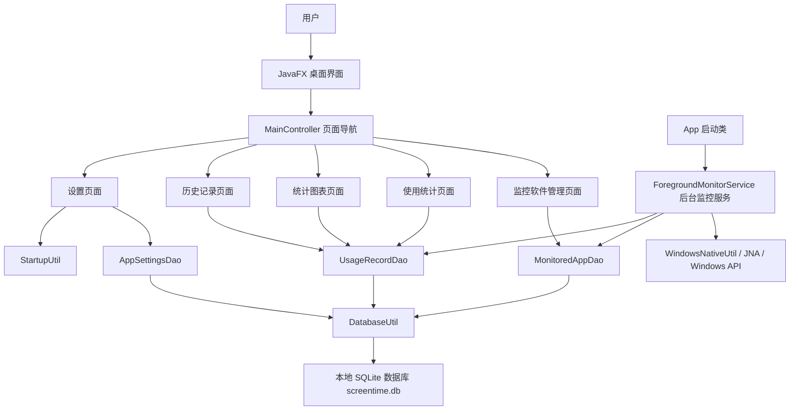

# 屏幕使用时间管理系统应用报告

## 一、软件功能

本软件是一个运行在 Windows 桌面环境下的屏幕使用时间管理工具。它不是“服务器端 + 客户端”的分布式系统，而是一个单机桌面应用：用户在本机运行 JavaFX 图形界面，程序在后台定时读取当前前台窗口所属进程，并把被监控应用的使用时长记录到本地 SQLite 数据库中。

### 1. 主界面与页面导航

软件启动后显示主窗口，左侧是功能导航栏，右侧是当前功能页面。导航栏包含以下页面：

- 监控软件管理
- 使用统计
- 统计图表
- 统计历史记录
- 设置

实现文件：

- `src/main/java/com/screentime/App.java`：创建 JavaFX 主窗口，加载主界面，启动后台监控服务，处理窗口关闭和系统托盘逻辑。
- `src/main/java/com/screentime/Main.java`：程序启动入口，转发到 `App.main()`。
- `src/main/java/com/screentime/controller/MainController.java`：负责左侧导航按钮事件，根据按钮切换不同 FXML 页面。
- `src/main/resources/fxml/main.fxml`：主界面布局文件，定义左侧导航栏和右侧内容区域。

使用技术：

- JavaFX `Application`、`Stage`、`Scene`
- FXML 页面加载
- JavaFX 控制器
- 单窗口多页面切换

### 2. 监控软件管理功能

该页面用于选择需要统计使用时长的软件。用户可以刷新当前系统正在运行的进程列表，从中选择一个或多个进程加入监控列表；也可以从监控列表中移除应用。应用加入监控列表后，后台监控服务才会记录它的前台使用时长。

该页面还支持应用图标显示，以及“永久显示”标记。永久显示的应用最多允许设置 3 个，非永久应用在取消永久状态后会触发过期数据清理逻辑。

实现文件：

- `src/main/resources/fxml/monitor-list.fxml`：监控软件管理页面布局。
- `src/main/java/com/screentime/controller/MonitorListController.java`：实现刷新进程、添加监控应用、移除监控应用、显示图标、设置永久显示等交互。
- `src/main/java/com/screentime/dao/MonitoredAppDao.java`：负责 `monitored_apps` 表的数据增删查改，包含软删除、恢复历史应用、永久显示状态维护和过期数据清理。
- `src/main/java/com/screentime/model/ProcessInfo.java`：表示系统进程信息。
- `src/main/java/com/screentime/model/MonitoredApp.java`：表示被监控应用。
- `src/main/java/com/screentime/util/IconUtil.java`：从应用可执行文件中提取图标并缓存。

使用技术：

- Java `ProcessHandle.allProcesses()` 枚举系统进程
- JavaFX `ListView`、`ListCell`、`CheckBox`
- 后台线程池 `ExecutorService`
- DAO 模式访问数据库
- SQLite 持久化

### 3. 后台前台应用监控功能

这是软件的核心功能。程序后台定时获取当前 Windows 前台窗口所属进程，如果该进程在监控列表中，就开始或延续一段使用会话；如果用户切换到其他应用、进入空闲状态、程序关闭或轮询中断，就结束当前会话并写入使用时长。

实现文件：

- `src/main/java/com/screentime/service/ForegroundMonitorService.java`：后台监控服务，负责定时轮询前台窗口、匹配监控应用、开始/更新/结束使用会话。
- `src/main/java/com/screentime/util/WindowsNativeUtil.java`：通过 JNA 调用 Windows 原生 API 获取前台窗口进程和用户空闲时间。
- `src/main/java/com/screentime/dao/UsageRecordDao.java`：负责开始会话、心跳更新、结束会话、跨天拆分、恢复未关闭会话、查询统计数据。
- `src/main/java/com/screentime/dao/MonitoredAppDao.java`：提供被监控应用列表，供监控服务匹配进程。

使用技术：

- JNA 调用 Windows API
- `User32.GetForegroundWindow()` 获取前台窗口句柄
- `User32.GetWindowThreadProcessId()` 获取窗口所属进程 ID
- `Kernel32.QueryFullProcessImageName()` 获取进程可执行文件路径
- `User32.GetLastInputInfo()` 获取用户空闲时间
- `ScheduledExecutorService` 定时轮询
- `ConcurrentHashMap` 缓存应用路径和图标信息
- SQLite 事务写入使用记录

### 4. 今日使用统计功能

该页面展示当天各个被监控应用的使用时长。页面通过表格显示应用图标、应用名称和今日累计使用时间，并支持手动刷新。

实现文件：

- `src/main/resources/fxml/statistics.fxml`：今日使用统计页面布局。
- `src/main/java/com/screentime/controller/StatisticsController.java`：读取今日使用数据并展示到表格。
- `src/main/java/com/screentime/dao/UsageRecordDao.java`：`getTodayUsage()` 查询今日已完成会话和正在进行中的会话。
- `src/main/java/com/screentime/util/TimeUtil.java`：把秒数格式化成可读的时长文本。

使用技术：

- JavaFX `TableView`
- `PropertyValueFactory`
- SQLite 聚合查询
- Java `LocalDate`、`LocalDateTime` 处理日期范围

### 5. 统计图表功能

该页面用图形化方式展示使用数据，包括柱状图、饼图和排行表。柱状图用于展示最近一段时间不同应用的使用趋势，饼图用于展示今日使用占比，排行表用于展示今日、本周、本月的使用分钟数。

实现文件：

- `src/main/resources/fxml/chart.fxml`：统计图表页面布局。
- `src/main/java/com/screentime/controller/ChartController.java`：从 DAO 获取历史数据，组装柱状图、饼图和排行表数据。
- `src/main/java/com/screentime/dao/UsageRecordDao.java`：`getRecentUsageHistory()`、`getDaysUsage()` 等方法提供图表所需数据。
- `src/main/java/com/screentime/dao/MonitoredAppDao.java`：提供应用 ID 和应用名称的映射。

使用技术：

- JavaFX `BarChart`
- JavaFX `PieChart`
- JavaFX `TableView`
- Java 集合 `Map` 分组统计
- 日期范围计算

### 6. 历史记录功能

该页面以表格形式展示历史使用记录，包括应用名称、日期和当天累计使用时长。它不是只读取已经汇总的历史表，而是结合 `usage_records` 中的会话记录计算近期历史，避免当天数据未到午夜汇总时无法显示。

实现文件：

- `src/main/resources/fxml/history.fxml`：历史记录页面布局。
- `src/main/java/com/screentime/controller/HistoryController.java`：加载并展示历史使用记录。
- `src/main/java/com/screentime/dao/UsageRecordDao.java`：`getRecentUsageHistory()` 查询并按应用、日期分组统计。
- `src/main/java/com/screentime/util/TimeUtil.java`：格式化时长。

使用技术：

- JavaFX `TableView`
- SQLite 查询
- Java `Map<String, Map<LocalDate, Integer>>` 分组数据结构

### 7. 设置功能

设置页面提供程序行为和数据操作配置，包括：

- 是否关闭到系统托盘
- 是否开机自启
- 是否开机后最小化启动
- 最小会话时长设置
- 使用记录 CSV 导出
- 使用记录 CSV 导入

实现文件：

- `src/main/resources/fxml/settings.fxml`：设置页面布局。
- `src/main/java/com/screentime/controller/SettingsController.java`：处理设置项、导入导出、后台任务。
- `src/main/java/com/screentime/dao/AppSettingsDao.java`：保存键值对设置项。
- `src/main/java/com/screentime/util/StartupUtil.java`：通过 Windows 注册表管理开机自启。
- `src/main/java/com/screentime/dao/UsageRecordDao.java`：提供 CSV 导出数据、导入 CSV 并写入数据库。

使用技术：

- JavaFX `CheckBox`、`Spinner`、`Button`
- JavaFX `FileChooser`
- JavaFX `Task` 后台任务
- CSV 解析与转义
- Windows 注册表 `reg add` / `reg delete`
- SQLite 数据导入导出

### 8. 系统托盘功能

软件支持关闭窗口时最小化到系统托盘，而不是直接退出。用户可以从托盘菜单重新显示主窗口或退出程序。

实现文件：

- `src/main/java/com/screentime/App.java`：创建 `TrayIcon`，处理托盘菜单和窗口关闭事件。
- `src/main/java/com/screentime/dao/AppSettingsDao.java`：保存关闭到托盘和开机最小化等设置。

使用技术：

- AWT `SystemTray`
- AWT `TrayIcon`
- JavaFX 与 AWT 线程协作：`Platform.runLater()`

## 二、软件架构

### 1. 独立程序组成

本软件由一个可独立运行的桌面程序组成，不包含独立服务器端，也不包含独立客户端进程。所有功能都运行在本机同一个 Java 进程中。

程序内部可以按职责划分为 5 层：

- 界面层：JavaFX 页面和控制器
- 服务层：后台前台应用监控服务
- 数据访问层：DAO 类
- 工具层：Windows API、数据库连接、图标、时间、开机自启等工具
- 数据层：本地 SQLite 数据库

### 2. 架构框图



### 3. 数据库结构

数据库使用 SQLite，运行时自动创建在：

```text
%USERPROFILE%/ScreenTime/screentime.db
```

建表脚本：

```text
src/main/resources/database/schema.sql
```

主要数据表：

| 表名 | 作用 | 主要字段 |
| --- | --- | --- |
| `monitored_apps` | 保存被监控应用列表 | `id`、`app_name`、`process_name`、`is_active`、`is_permanent` |
| `usage_records` | 保存单次使用会话 | `app_id`、`start_time`、`last_seen_time`、`end_time`、`duration_seconds` |
| `daily_summary` | 保存按天汇总后的使用时长 | `app_id`、`date`、`total_seconds` |
| `app_settings` | 保存软件设置 | `key`、`value` |

### 4. 主要技术与知识点

| 技术 | 用途 | 涉及文件 |
| --- | --- | --- |
| Java 21 | 项目主要开发语言 | 全部 `.java` 文件 |
| JavaFX | 构建桌面图形界面 | `App.java`、`controller/`、`resources/fxml/` |
| FXML | 声明式界面布局 | `src/main/resources/fxml/*.fxml` |
| Maven | 项目构建、依赖管理、测试运行 | `pom.xml` |
| SQLite | 本地数据持久化 | `schema.sql`、`dao/` |
| JDBC | Java 连接 SQLite 数据库 | `DatabaseUtil.java`、`dao/` |
| DAO 模式 | 分离业务逻辑和数据库访问 | `MonitoredAppDao.java`、`UsageRecordDao.java`、`AppSettingsDao.java` |
| JNA | 调用 Windows 原生 API | `WindowsNativeUtil.java` |
| Windows API | 获取前台窗口、进程路径、用户空闲时间 | `WindowsNativeUtil.java` |
| ScheduledExecutorService | 定时轮询前台应用 | `ForegroundMonitorService.java` |
| ExecutorService | 后台加载进程列表和图标 | `MonitorListController.java` |
| JavaFX Task | 设置页导入导出后台执行 | `SettingsController.java` |
| AWT SystemTray | 系统托盘功能 | `App.java` |
| CSV 处理 | 使用记录导入导出 | `SettingsController.java`、`UsageRecordDao.java` |
| JUnit 5 | 单元测试 | `src/test/java/` |

### 5. 功能实现映射表

| 功能 | 主要实现文件 | 实现方式 |
| --- | --- | --- |
| 程序启动 | `Main.java`、`App.java` | `Main` 作为入口，调用 JavaFX 应用 `App` |
| 主窗口显示 | `App.java`、`main.fxml` | 加载 FXML，创建 `Scene` 和 `Stage` |
| 页面切换 | `MainController.java` | 根据导航按钮加载不同 FXML 到 `StackPane` |
| 枚举运行中进程 | `MonitorListController.java` | 使用 `ProcessHandle.allProcesses()` 获取系统进程 |
| 添加监控应用 | `MonitorListController.java`、`MonitoredAppDao.java` | 用户选择进程后写入 `monitored_apps` |
| 删除监控应用 | `MonitorListController.java`、`MonitoredAppDao.java` | 使用软删除，把 `is_active` 置为 0 |
| 前台应用识别 | `ForegroundMonitorService.java`、`WindowsNativeUtil.java` | 定时调用 Windows API 获取前台进程 |
| 使用会话记录 | `ForegroundMonitorService.java`、`UsageRecordDao.java` | 前台应用开始时插入记录，切换或退出时结束记录 |
| 今日统计 | `StatisticsController.java`、`UsageRecordDao.java` | 查询今日已完成和进行中的会话并汇总 |
| 图表展示 | `ChartController.java`、`UsageRecordDao.java` | 查询历史数据后填充柱状图、饼图和排行表 |
| 历史记录 | `HistoryController.java`、`UsageRecordDao.java` | 按应用和日期分组显示使用历史 |
| 设置保存 | `SettingsController.java`、`AppSettingsDao.java` | 使用 `app_settings` 保存键值对配置 |
| 开机自启 | `SettingsController.java`、`StartupUtil.java` | 调用 Windows 注册表命令写入或删除启动项 |
| 关闭到托盘 | `App.java` | 使用 AWT `SystemTray` 和 `TrayIcon` |
| CSV 导出 | `SettingsController.java`、`UsageRecordDao.java` | 查询最近记录并写入 UTF-8 CSV |
| CSV 导入 | `SettingsController.java`、`UsageRecordDao.java` | 解析 CSV，校验字段，写入使用记录 |
| 数据库初始化 | `DatabaseUtil.java`、`schema.sql` | 程序运行时自动执行建表脚本和简单迁移 |

### 6. 关键实现流程

#### 6.1 前台应用使用时长记录流程

1. `App.start()` 启动 JavaFX 主窗口。
2. `App.start()` 调用 `ForegroundMonitorService.getInstance().start()` 启动后台监控。
3. `ForegroundMonitorService` 使用 `ScheduledExecutorService` 按固定间隔执行 `poll()`。
4. `poll()` 调用 `WindowsNativeUtil.getForegroundProcessInfo()` 获取当前前台进程。
5. 服务从 `MonitoredAppDao.findAll()` 加载被监控应用，并按进程名匹配当前前台进程。
6. 如果匹配到新应用，调用 `UsageRecordDao.startSession()` 开始新会话。
7. 如果仍是同一应用，调用 `UsageRecordDao.heartbeatSession()` 更新最后活跃时间。
8. 如果切换到非监控应用、用户空闲或程序退出，调用 `UsageRecordDao.endSession()` 结束会话并计算时长。

#### 6.2 数据统计展示流程

1. 用户进入“使用统计”“统计图表”或“历史记录”页面。
2. 对应 Controller 调用 `UsageRecordDao` 查询数据库。
3. DAO 将 `usage_records` 和 `daily_summary` 中的数据按日期和应用聚合。
4. Controller 将结果转换成 JavaFX 表格、柱状图、饼图需要的数据结构。
5. 页面刷新显示最新统计结果。

#### 6.3 设置保存流程

1. 用户在设置页修改复选框、数值或导入导出数据。
2. `SettingsController` 接收界面事件。
3. 普通设置写入 `AppSettingsDao`。
4. 开机自启调用 `StartupUtil` 修改 Windows 注册表。
5. CSV 导入导出通过 JavaFX `Task` 在后台线程执行，避免阻塞界面。

## 三、总结

该软件的核心价值是把“当前正在使用哪个应用”转换成可统计的本地数据。界面层负责交互，监控服务负责采集，DAO 层负责存储，SQLite 负责持久化。架构虽然不是大型分布式系统，但职责划分比较清晰：界面不直接调用 Windows API，监控服务不直接操作界面，数据库访问集中在 DAO 中。

需要注意的是，本项目强依赖 Windows 原生 API，因此它的核心监控功能并不具备跨平台能力。如果后续要提升工程质量，应该优先处理源码注释和 FXML 文本的编码问题，并补充更完整的运行截图、测试用例和打包说明。
